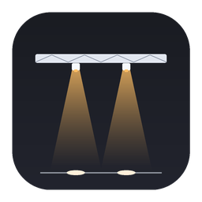
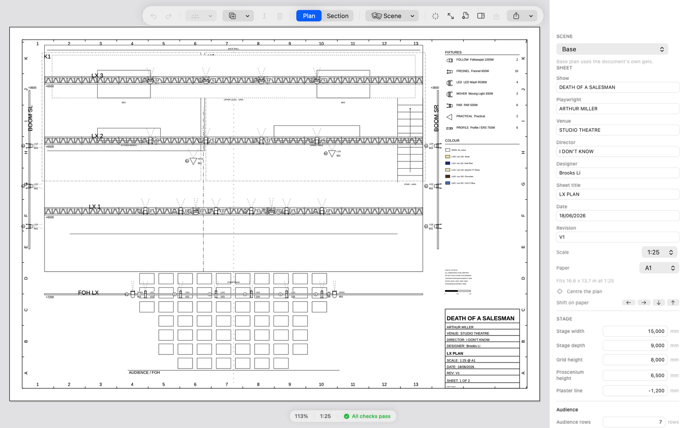
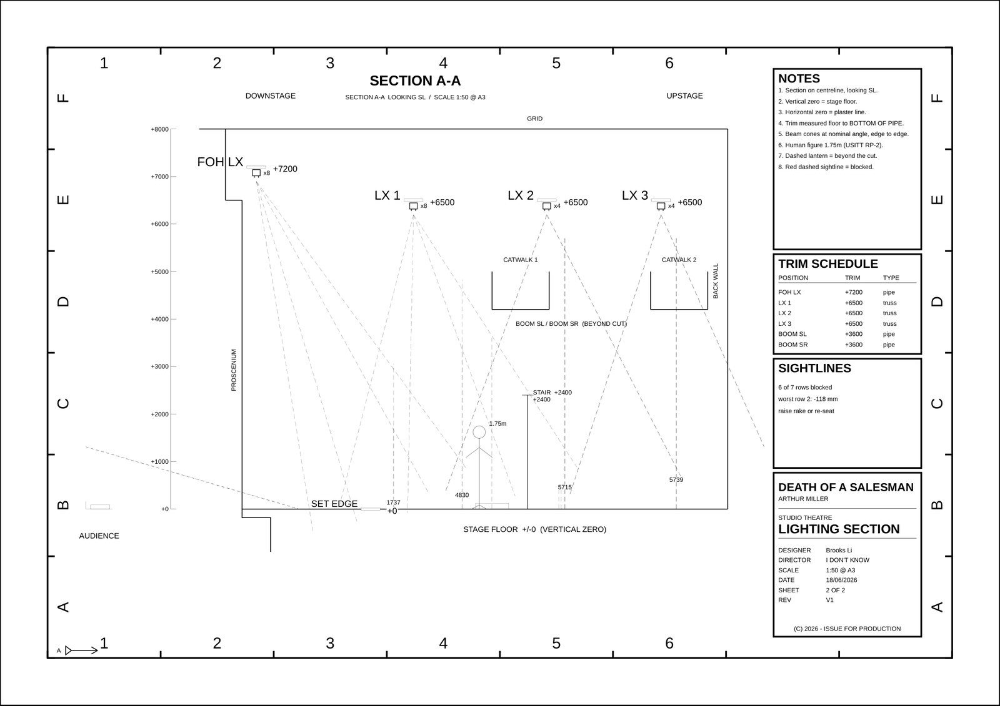

<div align="center">



# LightPlot

**A stage-lighting drafting app for macOS.** Drag lanterns onto trusses, get a true-scale plot.

English · **[中文](README.zh-CN.md)**

[](https://github.com/LunWhale/lightplot/releases/latest)


</div>



---

## Read this first

This is a student project, and it shows. Being upfront about it saves us both time:

> This project started out to serve the **HSC Drama lighting design individual project**. At first it was only a pipeline; the GUI has just been finished.
>
> The overwhelming majority of the code is **vibe coded**, with the model **`deepseek-v4.1-flash-1017`**. No guarantee of quality.
>
> In fact, HSC students can take inspiration from this. But sadly this is our last year — from next year, lighting won't be an option any more. (I finally understand why. If you hook up a large language model, you could do ten HSC IPs in a day.)
>
> The code and the UI are both pretty rough — basically just good enough to use. Also, the pipeline *can* export DWG files, but that isn't wired up in the app right now (and it's unlikely to ever be wired up in the iPad version). I'll update it whenever. The author's head hurts — going to sleep.

So: **use it, learn from it, fork it — but don't ship a bridge on it.**

---

## What it actually is

Two things live in this repo:

| | What | Where |
|---|---|---|
| **1** | **LightPlot** — a native macOS/iPadOS app: infinite canvas, snapping, a fixture library, Lee/Rosco gel colours, and PDF export at true scale | `app/` |
| **2** | The **original Python pipeline** — YAML in, PDF/DXF/CSV out. Kept as a fallback and as the regression oracle the app is tested against | `src/` |

Both read the same `data/rig.yaml`.

---

## Why true scale matters

The one promise this project keeps absolutely:

> **The plan prints as A1 at 1:25. The section prints as A3 at 1:50. Measure it with a ruler and it matches reality.**

Every export is measured by the test suite — not "looks about right", but the PDF's actual page geometry parsed back out and compared:

```
LX_plan.pdf      841.0 × 594.0 mm   (A1 @ 1:25)
LX_section.pdf   420.0 × 297.0 mm   (A3 @ 1:50)
```

If the content doesn't fit the chosen sheet, **the app does not silently shrink the drawing**. It prints a notice page explaining what fit where. A wrong-scale drawing is worse than no drawing, because someone will measure from it.

---

## Download & install

Grab the `.dmg` from [**Releases**](https://github.com/LunWhale/lightplot/releases/latest).

1. Open the DMG, drag **LightPlot** onto **Applications**
2. First launch: the build is **ad-hoc signed** (no Apple Developer certificate), so macOS will say *"cannot verify the developer"* — this is a missing certificate, not a corrupt file. Right-click the app → **Open** → **Open**, or run:

   ```bash
   xattr -dr com.apple.quarantine /Applications/LightPlot.app
   ```

Requires macOS 14 or later. Universal binary: Apple silicon and Intel both run.

The UI follows your system language — Chinese systems get Chinese, everyone else gets English. **The drawing itself is always ASCII**; that's a hard constraint for the DXF/PDF deliverables.

---

## Build from source

```bash
cd app
./run.sh                # validate data → render everything → compare against the reference PDFs
./run.sh --check        # validate only
./run.sh --app          # build and launch the GUI
./package.sh            # produce dist/LightPlot.app + dist/LightPlot-0.001.dmg
swift test              # 415 tests
```

Open `app/LightPlot.xcodeproj` in Xcode if you prefer. The project file is generated from `app/project.yml` with [XcodeGen](https://github.com/yonaskolb/XcodeGen).

The Python pipeline still works if you want the CAD output:

```bash
./run.sh                # → out/ (PDF, DXF, CSV, DWG)
./run.sh --check
```

---

## What it does

| You want to | In LightPlot |
|---|---|
| Enter the real venue dimensions | Inspector → **Stage** (width / depth / grid / proscenium / audience rake) |
| Enter show, playwright, venue, director, designer | Inspector → **Sheet** |
| Change paper size | ⌘⇧P **Page Setup** — A0–A4, Letter, Tabloid, portrait or landscape, with a live "this sheet holds 16.6 × 13.7 m" readout |
| Move around freely | Infinite canvas — scroll to pan, pinch to zoom |
| Draw a truss or pipe | Toolbar → **Truss**; drag either end to resize |
| Join two trusses into one | Select both → **Join** (only when collinear and the gap is ≤30 mm) |
| Hang a lantern | Select a truss → the lantern menu; it snaps onto the bar |
| Slide a lantern along its bar | Just drag it |
| Re-aim a lantern | Inspector aim slider, or the ↑↓←→ buttons |
| Pick a gel | Inspector — colour swatches show the real gel colour |
| Check for mistakes | The status bar light / the Checks panel |
| Export | **Sheet PDF**, or ⌘⇧E |

The section drawing is where the app goes past the original pipeline: trim schedule, per-row lantern counts, beam reach in millimetres, and a sightline check that reports which audience rows are blocked and by how much.



---

## What it deliberately does *not* do

- **No illuminance calculation.** Beam cones show direction and spread, not brightness. Real illuminance needs photometric curves and room reflections that simply aren't in the drawing data — a pretty fake light pool is worse than none.
- **No DXF/DWG export from the app.** The app writes PDF and CSV. The CAD files come from the Python pipeline (`out/cad/`, needs `ezdxf` + ODA File Converter for DWG). See the note above about DWG being un-shipped.
- **No 3D.**
- **Not a Vectorworks replacement.** Vectorworks does general geometry; this does one thing — lighting plots — and knows things Vectorworks doesn't (what L201 looks like, whether two scenes actually contrast).

---

## How it's tested

This part is more carefully built than the UI, because "looks right" is not a passing grade.

```
415 tests / 60 suites
```

- **Fault injection** — every lint rule has a case that injects exactly that fault, plus a meta-test that fails if a rule has no case.
- **App ≡ CLI** — the GUI and the command line must produce **byte-identical** PDFs (after normalising the PDF timestamp and document ID, which by spec vary per file).
- **Differential oracle** — the app's output is compared against the *actual PDFs the Python pipeline produced*: page size, instrument total, and all 30 lantern→gel pairs across three sheets, including the two scene overrides.
- **Geometry against DXF** — 69 same-type lantern pairs whose relative spacing must match the old DXF to zero error.
- **Paper sweep** — 7 sizes × 2 orientations × 5 scales on real data: if it fits there must be zero overlapping text and the stated scale must be true; if it doesn't fit there must be a notice page naming the sheet.
- **Determinism** — `lpx --reproducible` pins dates and document IDs so the same data yields the same bytes.
- **Reachability** — a static check that every one of the 27 editor actions is actually reachable from the UI. "Implemented but unreachable" is the same as "not implemented" to a user.

Known honest gaps are listed in [`app/PROGRESS.md` §8](app/PROGRESS.md); the open work is in [`TASKS.md`](TASKS.md).

---

## Repo layout

```
app/                     LightPlot — Swift package + Xcode project
  Sources/LightPlotCore/   geometry, paper grammar, model, editor, drawing, export
  Sources/LightPlotUI/     SwiftUI canvas, inspector, page setup, localisation
  Sources/LightPlotApp/    app entry point
  Sources/lpx/             command line: lint / render / section / csv / verify-old
  Tests/                   415 tests
  package.sh               build .app + .dmg

src/                     original Python pipeline (kept as fallback + oracle)
data/                    rig.yaml, scenes.yaml, cue data, gel library
docs/                     drafting-language measurements, technical report
tools/                   golden-image regression, platform build gate
run.sh                   pipeline: one command, everything
```

---

## Your own show

Everything geometric lives in `data/rig.yaml` — stage size, hanging positions, lanterns, gels. Change the data, not the code. The app opens that file directly and writes it back.

`data/rig.yaml` in this repo is **a fictional 15 × 9 m black box**. Replace it with your venue's real dimensions before anyone measures a drawing made from it.

---

## License

MIT — see [LICENSE](LICENSE). Take it, learn from it, break it.

The bundled **Liberation Sans** font is under the SIL Open Font License; see `app/Sources/LightPlotCore/Resources/Fonts/`.
