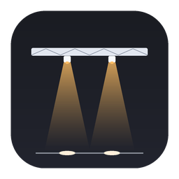
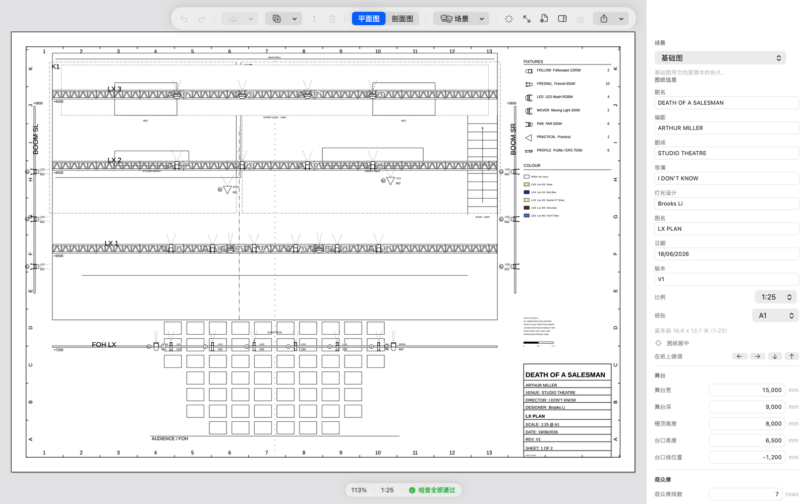
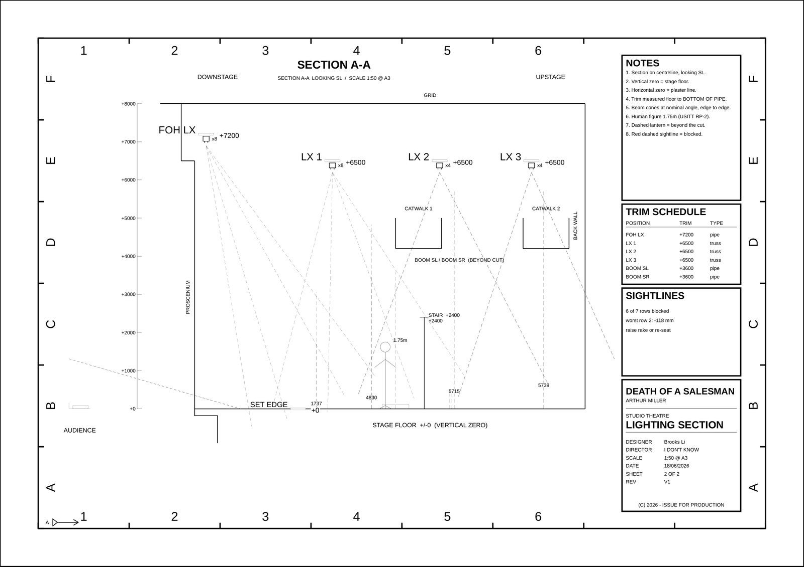

<div align="center">



# LightPlot

**Mac 上的舞台灯光设计出图工具。** 把灯拖到灯杆上，出一张量得到真实尺寸的图。

**[English](README.md)** · 中文

[](https://github.com/LunWhale/lightplot/releases/latest)


</div>



---

## 先说清楚

这是一个学生项目，而且看得出来。先把话说明白，省得你抱错期待：

> 本项目一开始是为了服务于 **HSC Drama 的 lighting design individual project**，一开始只是一个 pipeline，刚刚完善 GUI。
>
> 全项目绝大部分代码都是 **vibe coded**，模型 **`deepseek-v4.1-flash-1017`**，质量并不保证。
>
> 事实上，HSC 的学生可以从我这里获取灵感，但是可惜了我们是最后一年，明年 lighting 就不是可选项了（我终于知道为什么了，如果再接入大语言模型的话，一天可以做十个 HSC 的 IP）。
>
> 代码、界面都十分粗糙，其实基本就是凑合用。然后，这个 pipeline 是可以导出 DWG 文件的，但是现在没有实装（iPad 版本不太可能实装），以后随缘更新。作者脑袋疼，先去睡觉了。

所以：**拿去用、拿去学、拿去 fork —— 但别拿它去盖桥。**

---

## 这仓库里其实有两样东西

| | 是什么 | 在哪 |
|---|---|---|
| **1** | **LightPlot** —— 原生 Mac/iPad 应用：无限画布、吸附、灯具库、Lee/Rosco 色片、按真实比例导出 PDF | `app/` |
| **2** | **原来那套 Python 管线** —— 喂 YAML，出 PDF/DXF/CSV。留作兜底，同时当应用的回归基准（差分 oracle） | `src/` |

两者读同一份 `data/rig.yaml`。

---

## 唯一守死的那条承诺

> **平面图印出来是 A1、1:25；剖面图是 A3、1:50。拿尺子量，和现实一致。**

每份导出都被测试量过 —— 不是"看起来差不多"，而是把 PDF 的页面几何重新解析出来比对：

```
LX_plan.pdf      841.0 × 594.0 mm   (A1 @ 1:25)
LX_section.pdf   420.0 × 297.0 mm   (A3 @ 1:50)
```

装不下的时候，**应用不会偷偷把图缩小**，而是印一张说明页，写清哪里装不下。
一张比例错的图比没有图更危险 —— 有人会照着它量。

---

## 下载与安装

到 [**Releases**](https://github.com/LunWhale/lightplot/releases/latest) 下 `.dmg`。

1. 打开 DMG，把 **LightPlot** 拖到 **Applications**
2. 第一次打开：构建是 **ad-hoc 签名**（没有 Apple 开发者证书），所以 macOS 会提示「无法验证开发者」——
   这是缺证书，不是文件坏了。右键点应用 → **打开** → 再点 **打开**，或者执行：

   ```bash
   xattr -dr com.apple.quarantine /Applications/LightPlot.app
   ```

需要 macOS 14 或更高。通用二进制：Apple 芯片和 Intel 都能跑。

界面跟随系统语言 —— 中文系统显示中文，其余英文。
**图面永远是 ASCII**：这是 DXF/PDF 交付物的硬约束。

---

## 从源码构建

```bash
cd app
./run.sh                # 校验数据 → 出全套图 → 与参考 PDF 比对
./run.sh --check        # 只校验
./run.sh --app          # 编译并打开图形界面
./package.sh            # 产出 dist/LightPlot.app 与 dist/LightPlot-0.001.dmg
swift test              # 415 个测试
```

也可以 `open app/LightPlot.xcodeproj`。工程文件由 `app/project.yml` 经
[XcodeGen](https://github.com/yonaskolb/XcodeGen) 生成。

要 CAD 文件就走旧管线：

```bash
./run.sh                # → out/（PDF、DXF、CSV、DWG）
./run.sh --check
```

---

## 它能干什么

| 你想 | 在 LightPlot 里 |
|---|---|
| 填真实场地尺寸 | 检查器 → **舞台**（宽/深/栅顶/台口/观众席起坡） |
| 填剧名、编剧、剧场、导演、设计师 | 检查器 → **图纸信息** |
| 换纸幅 | ⌘⇧P **页面设置** —— A0–A4、Letter、Tabloid，横竖都行，实时告诉你「这张纸最多装 16.6 × 13.7 米」 |
| 像无边记一样自由移动 | 无限画布 —— 滚轮平移、捏合缩放 |
| 画桁架/管线 | 工具栏 → **Truss**，拖两端改长度 |
| 两根桁架接成一根 | 选中两根 → **Join**（共线且缝隙 ≤30mm 才会合） |
| 放灯 | 选中桁架 → 灯具菜单，灯自动吸在杆上 |
| 让灯沿杆滑动 | 直接拖 |
| 让灯转向 | 检查器里的角度滑杆，或点 ↑↓←→ |
| 选色片 | 检查器里选，色块显示真实颜色 |
| 检查错误 | 状态栏的绿灯 / 检查面板 |
| 出图 | **Export Sheet PDF**，或 ⌘⇧E |

剖面图是超过旧管线的地方：构件表、每排灯具计数、光束射程（毫米）、
以及视线检查 —— 报出哪几排观众看不见台面、差多少。



---

## 它刻意不做的事

- **不算照度。** 光束锥只表示朝向和光斑宽度，不表示多亮。真算照度需要光度曲线与
  环境反射，图纸数据里根本没有 —— 画一个好看的假光斑比不画更糟。
- **应用里不导 DXF/DWG。** 应用只出 PDF 和 CSV；CAD 文件由 Python 管线生成
  （`out/cad/`，需要 `ezdxf` + ODA File Converter 才能出 DWG）。
  前面那句"没有实装"说的就是这个。
- **不做 3D。**
- **不替代 Vectorworks。** 它擅长通用几何；这个只做一件事——灯光出图。

---

## 怎么测的

这部分比界面用心，因为「看起来对」不算通过。

```
415 个测试 / 60 个套件
```

- **故障注入** —— 每条校验规则都有一个"注入这个错"的用例，再加一条元测试：
  新增规则却不加用例，测试直接失败。
- **应用 ≡ 命令行** —— 两边必须产出**逐字节相同**的 PDF（先正规化 PDF 里
  按规范本就会变的生成时间与文档 ID）。
- **差分 oracle** —— 拿应用输出和**旧 Python 管线真实产出的 PDF** 比：
  页面尺寸、灯具总数、以及三张图上全部 30 组「灯号→色片」，含两个场景的替换。
- **几何对 DXF** —— 69 组同类型灯具两两间距，必须与旧 DXF 零误差。
- **纸张扫描** —— 7 种幅面 × 2 朝向 × 5 个比例 × 真实数据：装得下就必须零文字重叠、
  且图上印的比例是真的；装不下就必须出提示页并点名是哪张纸。
- **确定性** —— `lpx --reproducible` 钉住日期与文档 ID，同一数据出同一串字节。
- **可达性** —— 静态检查 27 个编辑动作是否都从界面够得着。
  "实现了但用户碰不到"和"没实现"对用户来说是一回事。

已知的诚实缺口写在 [`app/PROGRESS.md` §8](app/PROGRESS.md)，待办在 [`TASKS.md`](TASKS.md)。

---

## 目录结构

```
app/                     LightPlot —— Swift 包 + Xcode 工程
  Sources/LightPlotCore/   几何、图纸语法、模型、编辑器、绘制、导出
  Sources/LightPlotUI/     SwiftUI 画布、检查器、页面设置、本地化
  Sources/LightPlotApp/    应用入口
  Sources/lpx/             命令行：lint / render / section / csv / verify-old
  Tests/                   415 个测试
  package.sh               打包 .app + .dmg

src/                     原来的 Python 管线（兜底 + 回归基准）
data/                    rig.yaml、scenes.yaml、cue 数据、色片库
docs/                    制图语法的实测数据、技术报告
tools/                   黄金图回归、平台编译门禁
run.sh                   旧管线：一条命令出全套
```

---

## 换成你自己的戏

所有几何都在 `data/rig.yaml`：场地尺寸、吊挂位置、灯具、色片。
**改数据，不要改代码。** 应用直接打开这个文件、也写得回去。

仓库里这份 `data/rig.yaml` 是**虚构的 15 × 9 米黑箱**。
拿它出图给任何人量之前，先换成你剧场的真实尺寸。

---

## 许可

MIT —— 见 [LICENSE](LICENSE)。拿去用、拿去学、弄坏了也别找我。

内置的 **Liberation Sans** 字体按 SIL Open Font License 分发，
见 `app/Sources/LightPlotCore/Resources/Fonts/`。
